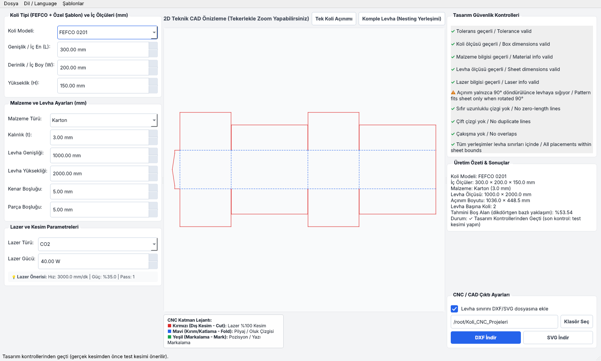
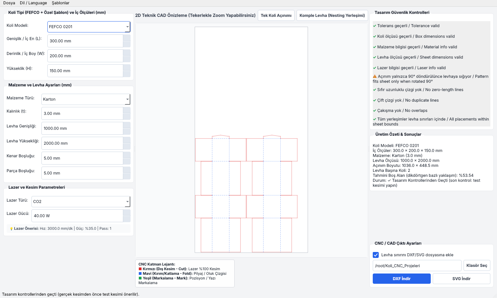
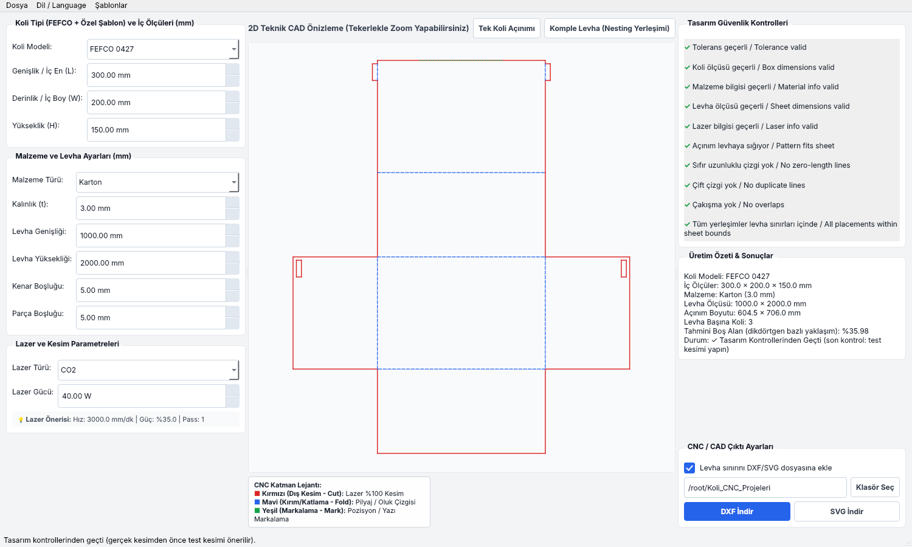
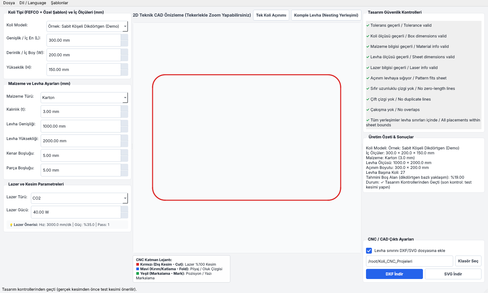

# KoliKesimApp

PyQt6 tabanlı, **tamamen yerel ve deterministik** koli tasarım ve lazer CNC
DXF üretim uygulaması.

> **Yapay zeka, AI API, chatbot veya LLM kullanılmaz.** Tüm hesaplamalar
> matematiksel/geometrik algoritmalarla (Shapely tabanlı) yapılır.

## Ekran Görüntüleri

| FEFCO 0201 açınımı | Levha üzerinde nesting |
|---|---|
|  |  |

| FEFCO 0427 (kilit kulaklı) | Kullanıcı şablonu (JSON) |
|---|---|
|  |  |

İngilizce arayüz: [docs/screenshots/05_english_ui.png](docs/screenshots/05_english_ui.png)

> Ekran görüntüleri başsız (offscreen) modda alınmıştır; gerçek masaüstünde
> yazı tipi ve spinbox okları platforma göre biraz farklı görünebilir.

---

## Kurulum / Installation

```bash
pip install -r requirements.txt
```

## Çalıştırma / Running

```bash
python -m kolikesimapp.main
```

## Testler / Tests

```bash
pytest tests/ -v
```

88 test; geometri, şablon motoru, nesting, doğrulama, DXF/SVG çıktısı,
proje dosyası ve GUI (offscreen) kapsanır. Linux'ta başsız çalıştırmak için:
`QT_QPA_PLATFORM=offscreen pytest tests/ -v`

---

## Mimari / Architecture

```
kolikesimapp/
├── core/
│   ├── models.py          # Product, Layout, Tolerance, BoxParams, Material, Sheet, Laser, Project
│   ├── geometry.py         # SADECE FEFCO formülleri (14 koli tipi) - şablonlardan habersiz
│   ├── templates.py        # Kullanıcı şablon motoru (JSON <-> ParametricTemplate) - geometry.py'den habersiz
│   ├── box_factory.py      # İKİSİNİ BİRLEŞTİREN TEK GİRİŞ NOKTASI -> generate_pattern(box, material)
│   ├── user_templates/     # Kullanıcının çizdiği kutular (VERİ, .json - kod değil)
│   │   └── demo_rounded.json
│   ├── nesting.py          # Tek levha üzerine grid tabanlı nesting
│   ├── validation.py       # Proje / açınım / nesting doğrulama kontrolleri
│   ├── laser.py            # Yerel (offline) lazer parametre öneri tablosu
│   ├── exporters.py        # ezdxf ile CUT/FOLD/MARK katmanlı DXF + SVG üretimi
│   └── project.py          # JSON proje kaydetme/açma
├── gui/
│   └── main_window.py      # PyQt6 ana pencere (tek, aktif kullanılan arayüz)
└── main.py                 # Giriş noktası (main_window.py'yi açar)
```

### Neden `geometry.py` / `templates.py` / `box_factory.py` üçe bölündü?

- **`geometry.py`**: yalnızca FEFCO formüllerini içerir (matematiksel olarak
  doğrulanmış, testlerle korunan kod). Kullanıcı şablonlarından **tamamen
  habersizdir** - hiçbir zaman onlardan etkilenip bozulamaz.
- **`templates.py`**: kullanıcının kendi çizip `user_templates/*.json`
  dosyasına yazdığı özel kutuları okur/üretir. `geometry.py`'den de
  habersizdir - yalnızca genel yapı taşlarını (`FlatPattern`, `Line`) kullanır.
- **`box_factory.py`**: ikisini birleştiren **tek** giriş noktası
  (`generate_pattern`). GUI, koli tipinin FEFCO mu yoksa kullanıcı şablonu mu
  olduğunu bilmek zorunda değildir - sadece bunu çağırır.

```python
from kolikesimapp.core.box_factory import generate_pattern
pattern = generate_pattern(box, material)   # FEFCO veya kullanıcı şablonu, farketmez
```

### Akış diyagramı

```
┌─────────────┐     ┌──────────────────┐     ┌───────────────────────┐
│  main.py    │────▶│  MainWindow      │────▶│ _collect_project()     │
│ (giriş)     │     │  (main_window.py)│     │ (form -> Project nesnesi)│
└─────────────┘     └──────────────────┘     └───────────┬────────────┘
                                                           │
                                                           ▼
                                           ┌───────────────────────────────┐
                                           │ box_factory.generate_pattern() │
                                           └───────────────┬───────────────┘
                                    box_type FEFCO mı?      │      box_type şablon mu?
                              ┌───────────────────────────┴───────────────────────────┐
                              ▼                                                         ▼
                 ┌─────────────────────────┐                          ┌──────────────────────────────┐
                 │ geometry.py              │                          │ templates.py                 │
                 │ BOX_GENERATORS[box_type] │                          │ TEMPLATE_REGISTRY[box_type]  │
                 │ (ör. generate_fefco_0201)│                          │ (user_templates/*.json'dan)  │
                 └────────────┬─────────────┘                          └───────────────┬──────────────┘
                              └──────────────────────┬──────────────────────────────────┘
                                                       ▼
                                             ┌───────────────────┐
                                             │   FlatPattern      │  (lines: CUT/FOLD/MARK)
                                             └─────────┬──────────┘
                              ┌────────────────────────┼─────────────────────────┐
                              ▼                        ▼                         ▼
                    ┌─────────────────┐      ┌──────────────────┐      ┌──────────────────┐
                    │ validation.py    │      │ nesting.py        │      │ exporters.py       │
                    │ (hata/uyarı ktrl)│      │ (levhaya yerleşim)│      │ (DXF/SVG dosyası)  │
                    └─────────────────┘      └──────────────────┘      └──────────────────┘
                              │                        │                         │
                              └────────────────────────┴─────────────────────────┘
                                                        ▼
                                          MainWindow ekranda gösterir /
                                          kullanıcı DXF/SVG indirir
```

### Yeni bir kutu tipi nasıl eklenir?

**FEFCO tarzı (matematik formülüyle, kod gerekir):**
`geometry.py`'ye `generate_fefco_XXXX_pattern(box, material)` fonksiyonu
ekleyin, `BOX_GENERATORS` sözlüğüne kaydedin, `models.py`'deki `BOX_TYPES`
tuple'ına ekleyin.

**Kendi çiziminiz (kod gerekmez):**
`user_templates/demo_rounded.json`'ı kopyalayıp yeni bir isimle kaydedin,
`points`/`segments` listesini kendi tasarımınıza göre düzenleyin. Uygulama
açılışında bu klasördeki tüm `.json` dosyaları otomatik yüklenir.

---

## Desteklenen Koli Tipleri / Supported Box Styles (14)

| Kod | Açıklama |
|---|---|
| `0200` | Kapaksız Basit Gövde (ekonomik, üst/alt kapak yok) |
| `0201` | Standart RSC Koli (dünyada en çok kullanılan) |
| `0202` | Kısmi Bindirmeli Koli |
| `0203` | Tam Bindirmeli Koli (FOL) |
| `0217` | Derin Kapaklı Teleskopik Kutu (arşiv/depolama) |
| `0301` | Sığ Kapaklı Teleskopik Kutu (ayrı taban + kapak) |
| `0421` | Kapaklı Kendinden Kilitli Kutu (pizza/hediye kutusu tarzı) |
| `0422` | Kendinden Kilitli Tepsi (dilli/yuvalı, yapıştırıcısız) |
| `0427` | Kendinden Kilitli Kargo Kutusu (kilit kulaklı / ear-lock, e-ticaret) |
| `0713` | Crash-Lock Otomatik Taban + Kilit Dilli Üst Kapak (fulfillment) |
| `handhole` | Taşıma Delikli Koli (0201 varyantı) |
| `partition` | Bölmeli Ayırıcı (şişe/cam ürün nakliyesi) |
| `display` | Perakende Teşhir Kutusu (POS) |
| `custom` | Özel Parametrik Koli (0201 tabanlı) |

Artı: `user_templates/` klasöründeki her `.json` dosyası otomatik olarak
listeye eklenir (örnek: `demo_rounded`).

---

## Geçmiş Düzeltmeler (Önemli Not)

Bu proje birden çok iterasyonda geliştirildi; en kritik iki düzeltme:

1. **Kapak derinliği yanlış eksene bağlıydı** — Yan panel kapakları
   yanlışlıkla `W`'ye bağlıydı, `L`'ye bağlı olması gerekirken. Bu, uzun/dar
   kutularda ortada kapanmayan bir boşluk bırakıyordu. `_rsc_flap_depths()`
   fonksiyonunda merkezi olarak düzeltildi.
2. **Bitişik kapaklar lazerle kesilmiyordu** — Kapaklar panel sınırına tam
   bitiştirilince, aralarındaki köşe yanlışlıkla "katlama" (FOLD) sanılıyor,
   kesim (CUT) olmuyordu - kapaklar birbirine yapışık kalıyordu. `FLAP_SLOT_GAP`
   (1mm) ile düzeltildi; `test_adjacent_flaps_are_cut_apart_not_fused_by_fold`
   testiyle kalıcı olarak korunuyor.

## Son Düzeltmeler (bu tur - dış inceleme sonrası)

Bir dış kod incelemesinin bulguları değerlendirildi; gerçek ve düşük riskli
olanlar uygulandı (bkz. proje sohbetindeki "hangi iddialar haklı / abartılı"
değerlendirmesi). "src/ layout", pyproject.toml/CI/semver gibi "endüstri
standardı" diye sunulan ama aslında tercih meselesi olan öneriler
**uygulanmadı** - tek geliştiricili bir masaüstü uygulaması için gereksiz.

1. **Bilinmeyen koli tipi artık sessizce FEFCO 0201'e dönmüyor** -
   `box_factory.generate_pattern()` artık net bir `UnknownBoxTypeError`
   fırlatır; GUI bunu yakalayıp ekranda açıkça gösterir. Önceki davranış
   (sessiz geçiş), kullanıcı fark etmeden yanlış geometrinin lazere
   gönderilmesine yol açabilirdi.
2. **"CNC Ready" / "Üretime Hazır" ifadesi kaldırıldı** - bu ifade, yazılımın
   kendi geometrik kontrollerini geçmekle gerçek makinede üretilebilir
   olmayı birbirine karıştırıyordu. Artık "Tasarım Kontrollerinden Geçti"
   deniyor ve test kesimi önerisi ekleniyor.
3. **"Tahmini Fire" etiketi netleştirildi** - bu değer gerçek malzeme
   firesi değil, parçanın dikdörtgen sınırlayıcı kutusunun levhada bıraktığı
   boş alan tahminidir; hem `NestingResult.waste_percent` docstring'inde hem
   de GUI'de bu açıkça belirtiliyor.
4. **Çıktı klasörü çakışma riski kapatıldı** - zaman damgasına saniye
   eklendi VE `ensure_unique_folder()` ile, aynı isimde klasör zaten varsa
   `_2`, `_3`, ... eklenerek önceki bir çıktının üzerine asla sessizce
   yazılmaması garanti edildi.
5. **`gui/controller.py` silindi** - hiçbir yerden çağrılmayan, üstüne
   içinde gerçek bir import hatası (`from core.models` olması gerekirken
   `from kolikesimapp.core.models`) barındıran ölü kod kaldırıldı.

## GUI Düzeltmeleri (ekran görüntüsü incelemesi sonrası)

Uygulama başsız (offscreen) modda çalıştırılıp ekran görüntüleri alınarak
incelendi; bulunan gerçek hatalar düzeltildi ve `tests/test_gui.py` ile
kalıcı olarak korunuyor:

1. **Yalnızca mm** - cm seçeneği ve tüm birim dönüşüm kodu kaldırıldı (mm/cm
   dönüşümünden doğan min/max/hassasiyet hataları artık imkânsız).
2. **Kontrol listesinde üst üste binen/hayalet metinler** - kök neden:
   `deleteLater()` silmeyi yalnızca erteler; `__init__` sırasında art arda
   tetiklenen hesaplamalar eski etiketleri görünür bırakıyordu. Artık
   `setParent(None)` ile anında koparılıyor; liste `QScrollArea` içinde ve
   her satırın sarmalanmış yüksekliği `QTextDocument` ile hesaplanıyor.
3. **"&" karakteri** başlıklarda kısayol sanılıp "_" görünüyordu (`&&` ile
   düzeltildi).
4. **Onay kutusunda tik görünmüyordu** - QSS `data:` URI desteklemediği için
   `gui/assets/checkbox_check.png` dosyasından yükleniyor.
5. **Dil değiştirme eksikti** - alan etiketleri, menüler, özet paneli ve lazer
   önerisi artık gerçekten TR/EN geçiyor. (Doğrulama mesajları ve katman
   lejantı bilinçli olarak her zaman iki dilli.)
6. Kesik görünen katman lejantı (word-wrap) ve `Fusion` stili (platformdan
   bağımsız tutarlı görünüm) eklendi.

## Kod İncelemesi Düzeltmeleri

1. **Güvenlik:** Şablon formülleri `eval()` ile hesaplanıyordu; boş
   `__builtins__` bir sandbox olmadığından kötü niyetli bir `.json` şablonu
   keyfi kod çalıştırabiliyordu. Artık AST tabanlı bir değerlendirici yalnızca
   sayı, değişken, `+ - * / // % **` ve `min/max/abs/round/sqrt/sin/cos`
   kabul eder.
2. **Şablon adı doğrulaması:** Ad aynı zamanda dosya adı olduğundan `../x`
   gibi yol atlatma engellendi; FEFCO kodlarıyla çakışan ad reddedilir.
   Tanımsız nokta / yanlış nokta sayısı yükleme sırasında net hatayla yakalanır.
3. **SVG yönelimi:** SVG'de Y ekseni aşağı doğru olduğundan çıktı DXF'e göre
   dikey ters çıkıyordu; artık aynı yönelimde.
4. **Proje dosyası:** `schema_version` eklendi, bilinmeyen alanlar yok sayılır,
   daha yeni sürüm veya bozuk dosya anlaşılır hata verir; GUI'de proje açma /
   kaydetme / şablon kopyalama hataları artık uygulamayı çökertmez, bilinmeyen
   koli tipi sessizce yutulmaz.

## Henüz Yok / Roadmap

- ⏳ 3D görüntüleme (açık/kısmen katlanmış/kapalı durumları)
- ⏳ Gerçek "irregular nesting" (şu an dikdörtgen grid nesting)
- ⏳ PDF rapor çıktısı
- ⏳ `user_templates/` için görsel (tıkla-çiz) bir düzenleyici arayüz
